# H&M CLV — Business Overview

35 saved questions across six tabs. These screenshots show aggregate analytical results from a historical portfolio project. The Metabase links require the owner's local instance and do not provide public interactive access.

### Overview

**Customer value and revenue concentration.** Observed buyers, discounted 12-month revenue CLV, next-90-day revenue, repeat buyers, high-value lapsed buyers, predicted tiers, monthly sales and value concentration.

**Business use:** Prioritize customer-value opportunities and monitor concentration.

[Open this tab on the owner's local Metabase instance](http://localhost:3000/dashboard/3-h-m-clv-business-overview?tab=8-overview)

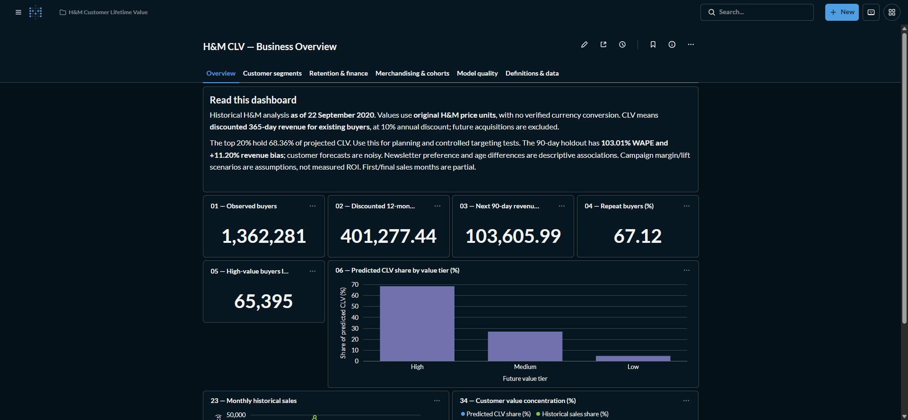

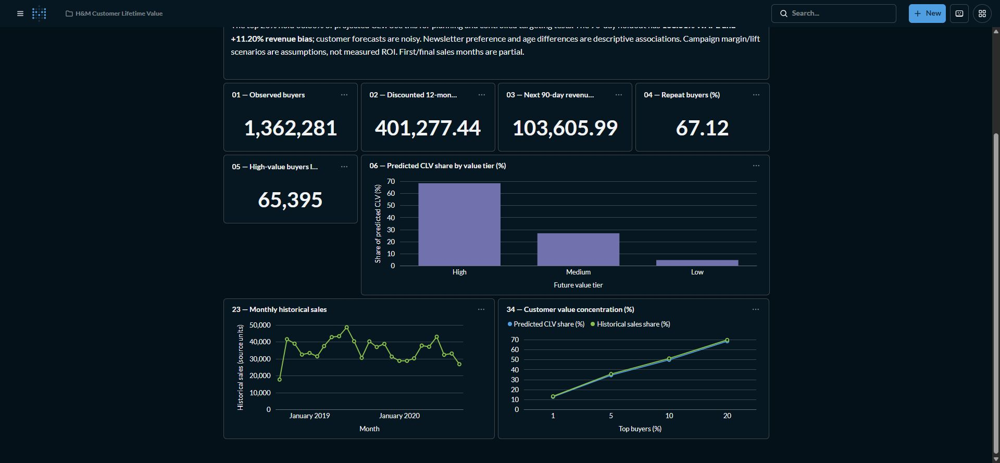

### Customer segments

**Who buys and how they behave.** Age, newsletter preference, membership, source FN/Active flags, frequency, recency, tenure, cross-segments and the complete segment KPI explorer.

**Business use:** Compare descriptive groups and design controlled CRM tests; preference is not newsletter send frequency.

[Open this tab on the owner's local Metabase instance](http://localhost:3000/dashboard/3-h-m-clv-business-overview?tab=9-customer-segments)

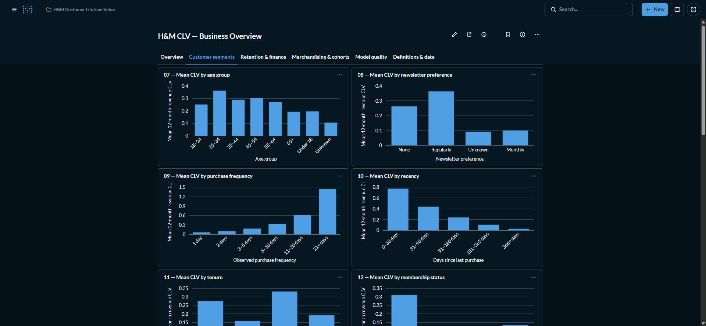

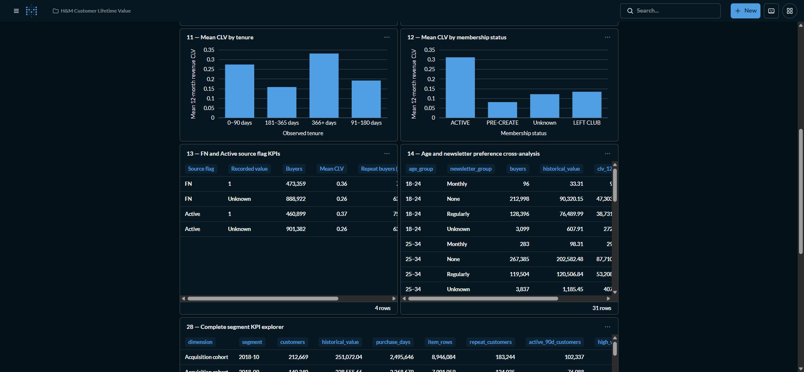

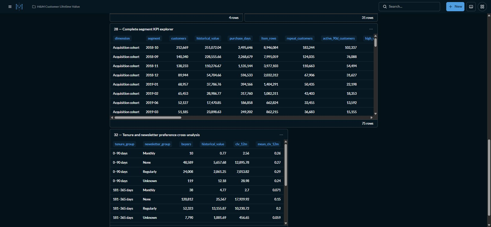

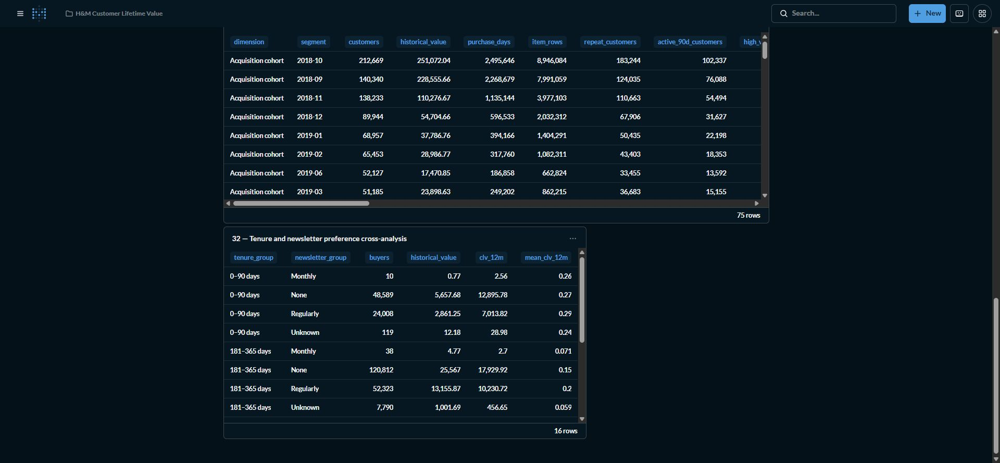

### Retention & finance

**Retention priorities and financial assumptions.** Suggested retention actions, margin/uplift budget scenarios, discount/demand sensitivity and historical-to-future value migration.

**Business use:** Compare possible campaign budgets under explicit assumptions; these are not measured campaign ROI.

[Open this tab on the owner's local Metabase instance](http://localhost:3000/dashboard/3-h-m-clv-business-overview?tab=10-retention-%26-finance)

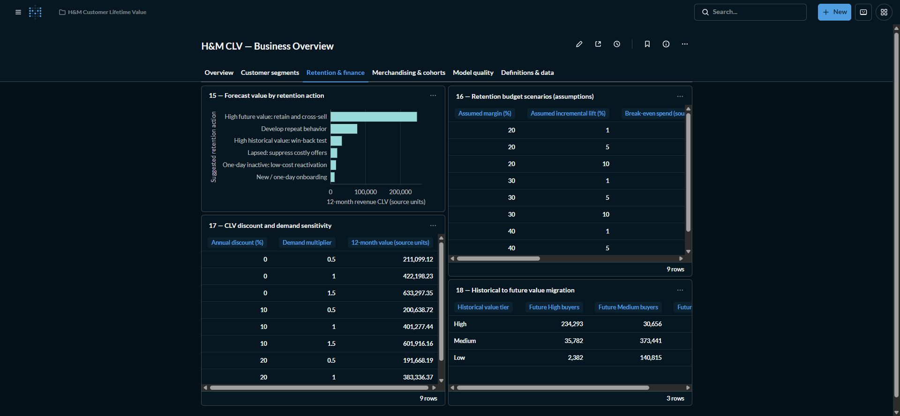

### Merchandising & cohorts

**Category affinity and customer continuity.** Category sales, channel activity, cohort retention, category affinity and complete cohort activity.

**Business use:** Connect assortment and capacity decisions with customer continuity; overlapping category buyers are not additive.

[Open this tab on the owner's local Metabase instance](http://localhost:3000/dashboard/3-h-m-clv-business-overview?tab=11-merchandising-%26-cohorts)

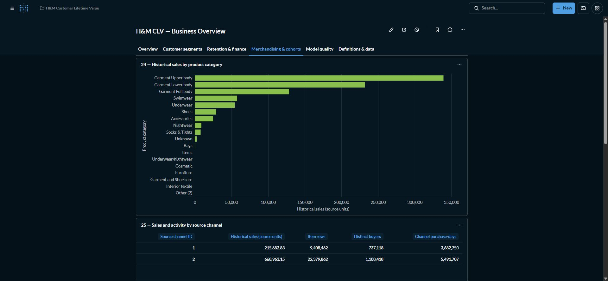

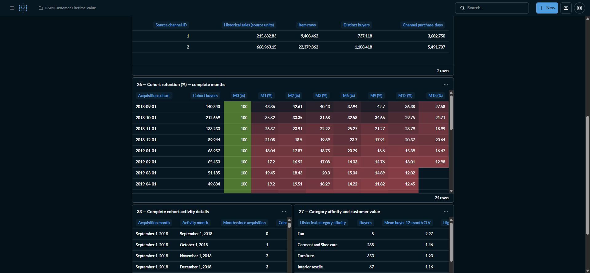

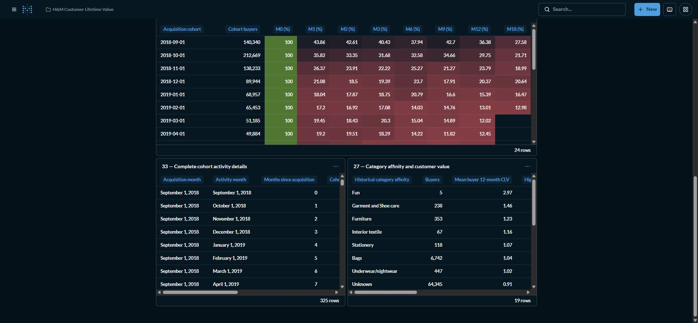

### Model quality

**Forecast evaluation and targeting quality.** Candidate comparison, selected-model metrics, holdout targeting, full validation/test results and limitations.

**Business use:** Assess forecast reliability and targeting concentration before spending on incentives.

[Open this tab on the owner's local Metabase instance](http://localhost:3000/dashboard/3-h-m-clv-business-overview?tab=12-model-quality)

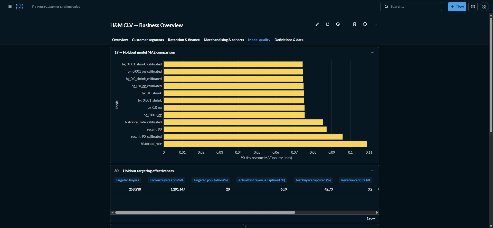

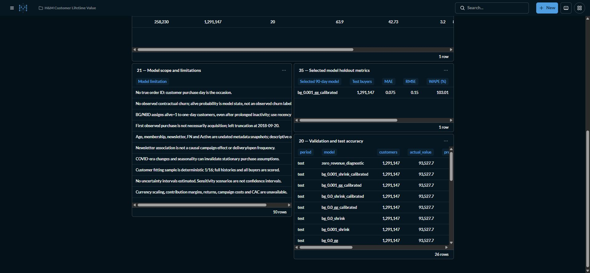

### Definitions & data

**KPI meaning and collection needs.** Portfolio KPI tables, formula dictionary and missing operational/commercial inputs.

**Business use:** Align KPI interpretation and plan the next data collection steps.

[Open this tab on the owner's local Metabase instance](http://localhost:3000/dashboard/3-h-m-clv-business-overview?tab=13-definitions-%26-data)

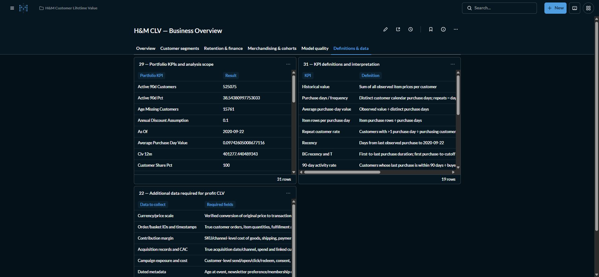

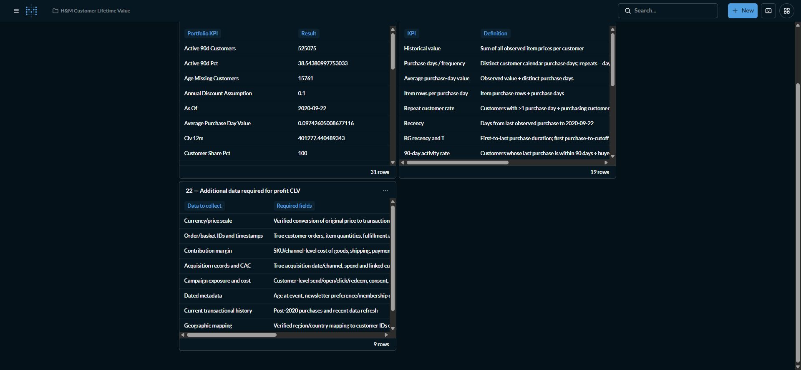
