# H&M Demand — Inventory Planning

34 saved questions across six tabs. Forecasts and inventory targets are historical planning demonstrations. The Metabase links require the owner's local instance and do not provide public interactive access.

### Executive overview

**Demand planning at portfolio level.** Four/eight-week volume forecasts, WAPE and bias, demand history, scenario bands, business findings and the complete KPI table.

**Business use:** Agree category capacity and planner review priorities.

[Open this tab on the owner's local Metabase instance](http://localhost:3000/dashboard/4-h-m-demand-inventory-planning?tab=14-executive-overview)

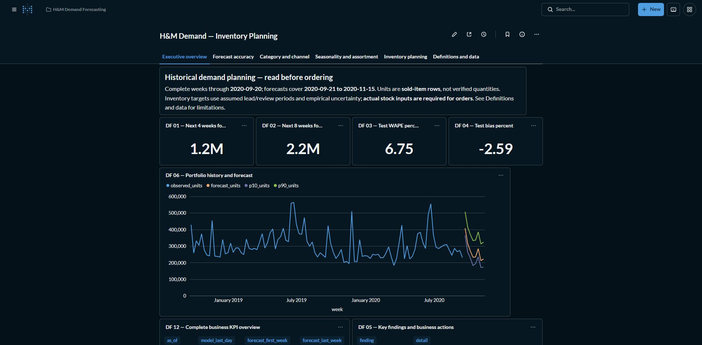

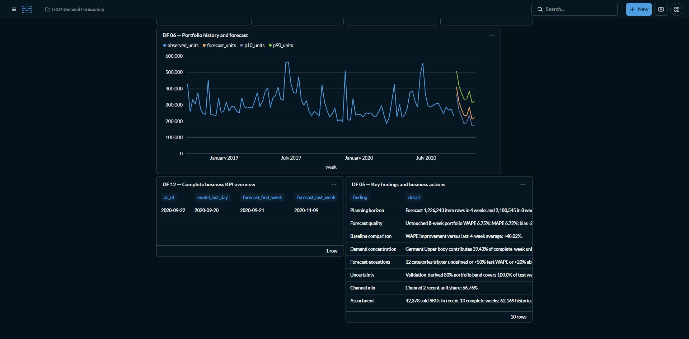

### Forecast accuracy

**How well demand forecasts performed.** Holdout actuals vs forecast, benchmarks, category errors, selected leaf models, validation folds, category holdout explorer, fit exceptions and portfolio/channel accuracy.

**Business use:** Choose defensible models and detect aggregate errors that hide category weaknesses.

[Open this tab on the owner's local Metabase instance](http://localhost:3000/dashboard/4-h-m-demand-inventory-planning?tab=15-forecast-accuracy)

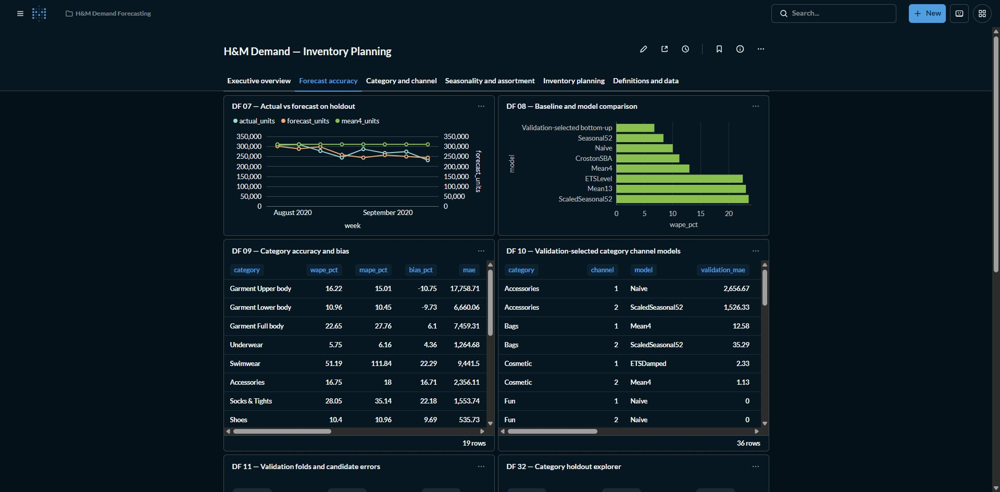

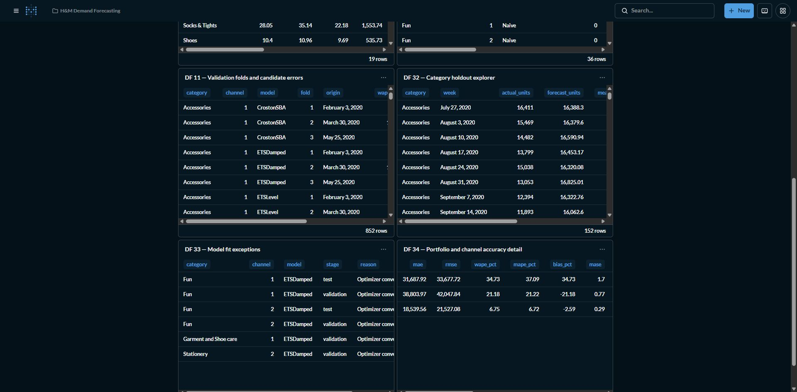

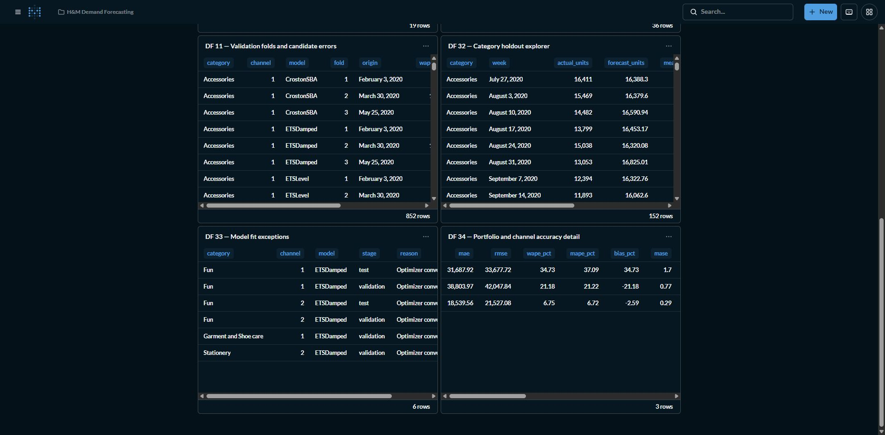

### Category and channel

**Where future volume is concentrated.** Category forecast volume, category KPIs, uncertainty explorer, weekly category selector and channel mix.

**Business use:** Allocate category/channel capacity and investigate demand shifts.

[Open this tab on the owner's local Metabase instance](http://localhost:3000/dashboard/4-h-m-demand-inventory-planning?tab=16-category-and-channel)

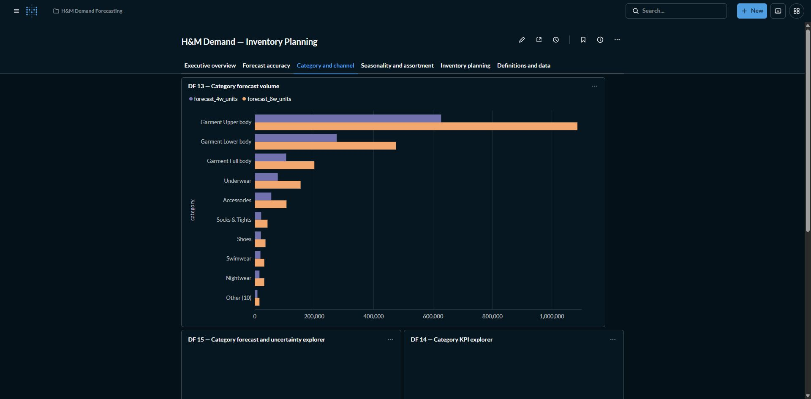

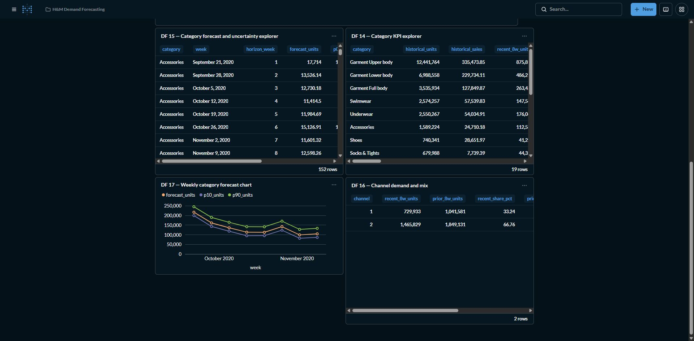

### Seasonality and assortment

**Calendar patterns and SKU priorities.** Complete-month demand, weekday patterns, month/category intensity, SKU ABC/XYZ, top SKUs and lifecycle.

**Business use:** Prioritize stable high-volume products and review erratic, inactive or newly observed lines.

[Open this tab on the owner's local Metabase instance](http://localhost:3000/dashboard/4-h-m-demand-inventory-planning?tab=17-seasonality-and-assortment)

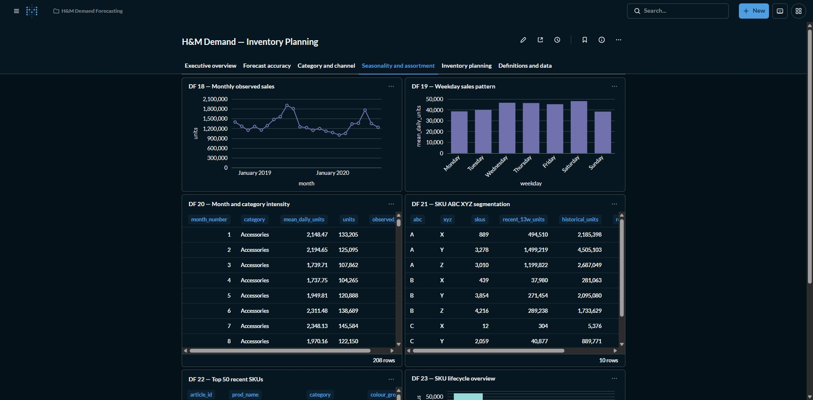

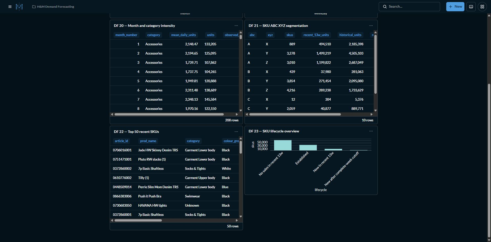

### Inventory planning

**Demand translated into policy scenarios.** 228 lead/review/quantile policies, illustrative stock targets, actual-input readiness, planner exceptions and category CLV context.

**Business use:** Compare demand protection periods and calculate shortfalls only after actual stock inputs are supplied.

[Open this tab on the owner's local Metabase instance](http://localhost:3000/dashboard/4-h-m-demand-inventory-planning?tab=18-inventory-planning)

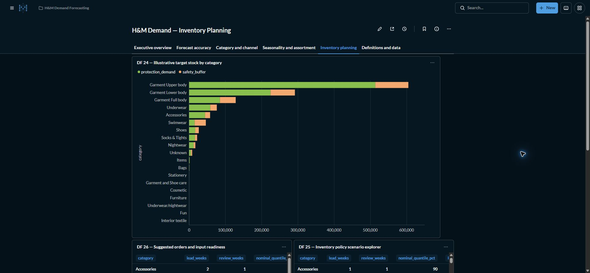

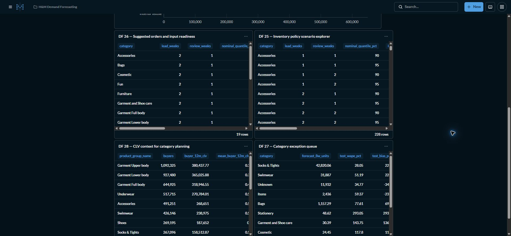

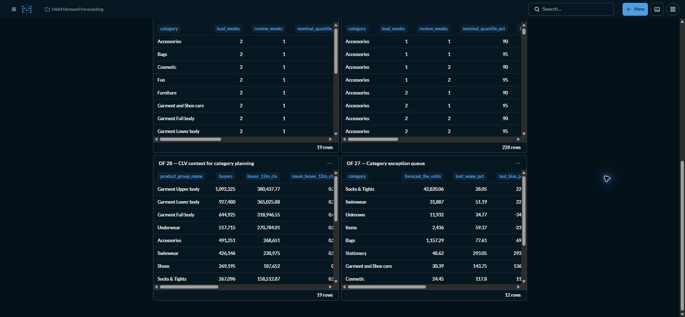

### Definitions and data

**Planning assumptions and missing inputs.** Source limitations, inventory assumptions, data requirements and KPI formulas.

**Business use:** Align units and collect stock, lead time, cost, availability and current transactions.

[Open this tab on the owner's local Metabase instance](http://localhost:3000/dashboard/4-h-m-demand-inventory-planning?tab=19-definitions-and-data)

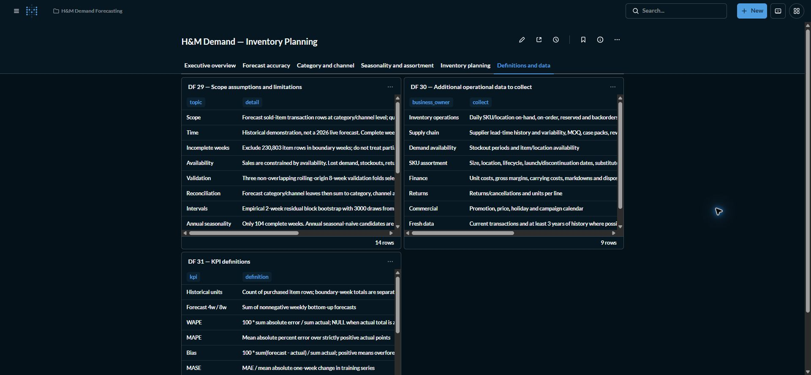

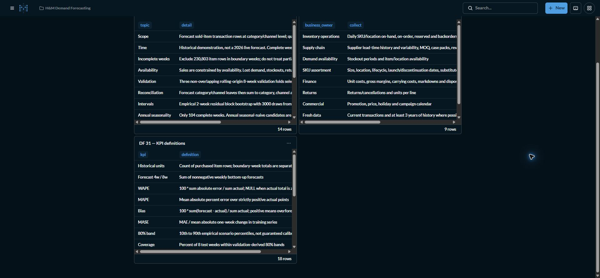
